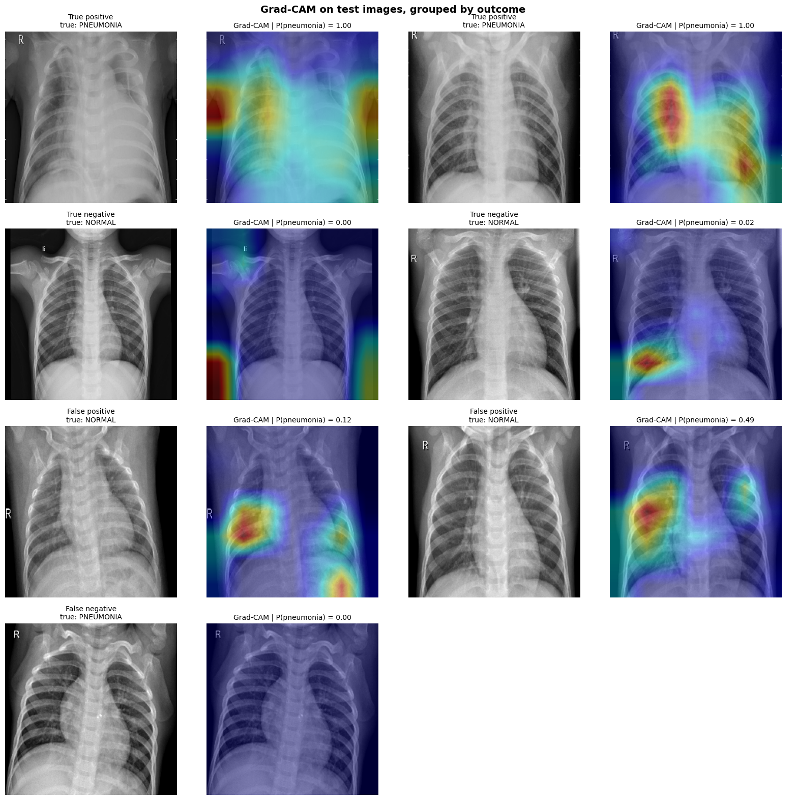
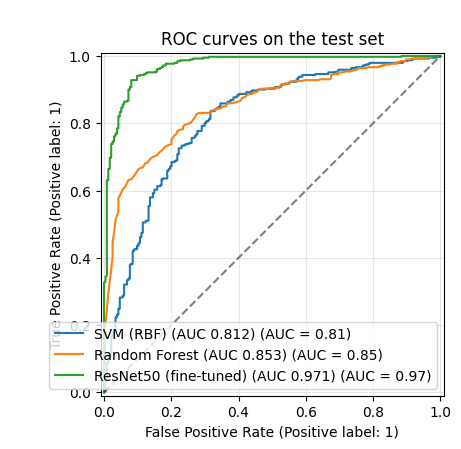
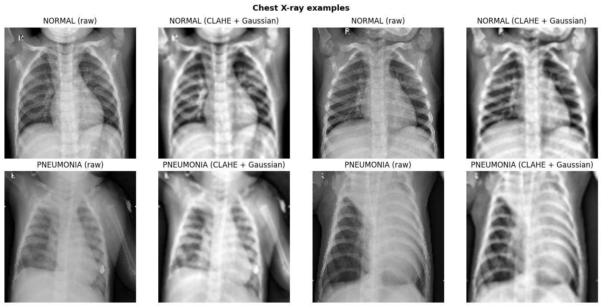
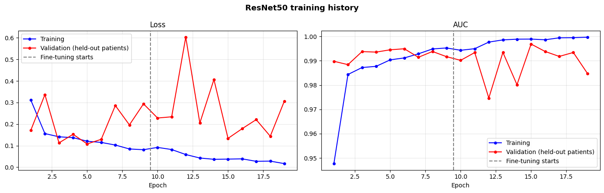

# Pneumonia Detection from Chest X-Rays: Classical ML vs. Fine-Tuned ResNet50

[](https://colab.research.google.com/github/MatasTerezas/chest-xray-pneumonia-classification/blob/main/notebooks/chest_xray_pneumonia_classification.ipynb)


A controlled comparison of two ways to classify pediatric chest X-rays as normal or pneumonia: classical machine learning on hand-crafted texture features (SVM, Random Forest) versus a two-stage fine-tuned **ResNet50**. All models use the same data, and the evaluation is designed to avoid the common leaks in this dataset: a patient-level validation split, hyperparameters chosen on validation only, and test metrics with patient-level bootstrap confidence intervals.



## Results

Official test set: 624 images from 428 patients (390 pneumonia, 234 normal). Single run, seed 42. Values are estimate [95% CI].

| Model | AUC | Sensitivity | Specificity | F1 |
|---|---|---|---|---|
| SVM (RBF) | 0.812 [0.776, 0.848] | 0.954 | 0.303 | 0.804 |
| Random Forest | 0.853 [0.825, 0.881] | 0.959 | 0.252 | 0.797 |
| **ResNet50 (fine-tuned)** | **0.971 [0.957, 0.983]** | **0.977 [0.960, 0.991]** | **0.808 [0.755, 0.860]** | **0.934 [0.913, 0.952]** |

Sensitivity, specificity and F1 are at the default decision threshold of 0.5. For the ResNet50, accuracy is 0.913 [0.889, 0.936] and precision is 0.894 [0.860, 0.926].



### What the results show

- **Deep learning clearly beats the classical baselines.** The AUC intervals do not overlap (0.97 vs. 0.81 to 0.85). The classical models catch most pneumonia cases but flag most healthy images as pneumonia (specificity 0.25 to 0.30).
- **A threshold tuned on validation data did not transfer.** Maximizing Youden's J on the validation patients gave a ResNet50 threshold of 0.048. On the test set this lowered specificity from 0.81 to 0.68 (sensitivity rose to 0.997). The validation images are easier than the official test set, so the threshold-free AUC and the default 0.5 operating point are the more trustworthy summaries.
- **Validation scores overstate test performance for every model.** Validation AUC was about 0.97 for the classical models and above 0.99 for the ResNet50, against 0.81 to 0.85 and 0.97 on the test set. The classical models drop the most, which suggests that their intensity and texture features pick up differences in image acquisition rather than disease alone.
- **Grad-CAM is encouraging but not conclusive.** Several heatmaps focus on the lungs, but at least two put strong activation on image borders and corners outside the lungs, a sign of possible shortcut learning. The ResNet50 numbers should not be read as proof that the model uses clinically meaningful features.

## Approach

- **Data:** [Chest X-Ray Images (Pneumonia)](https://www.kaggle.com/datasets/paultimothymooney/chest-xray-pneumonia) from Kaggle. The official `val` folder has only 16 images and is ignored. The official `train` folder is split 80/20 into training and validation images **by patient** (IDs parsed from file names), and the official `test` folder is used once for the final numbers. The notebook checks that no patient appears in more than one split.
- **Classical ML:** images resized to 128x128, Gaussian denoising, CLAHE contrast enhancement, then 52 features (20 GLCM texture features at four angles and a 32-bin intensity histogram). The SVM's `C` and the Random Forest's `min_samples_leaf` are chosen by validation AUC.
- **Deep learning:** ResNet50 with ImageNet weights, `tf.data` input pipeline and the model's own preprocessing. Augmentation inside the model (small rotations, zooms and shifts). Horizontal flips are deliberately not used because they change the anatomy of a chest X-ray. Inverse-frequency class weights. Stage 1 trains the new head with the backbone frozen; stage 2 fine-tunes the last 30 backbone layers (batch-norm layers frozen) with a small learning rate. Each stage restores the weights with the best validation AUC.
- **Uncertainty:** 95% confidence intervals from a bootstrap that resamples whole patients.
- **Interpretability:** Grad-CAM on test examples chosen by outcome (true and false positives and negatives) rather than hand-picked.

Example images before and after preprocessing (CLAHE contrast enhancement and Gaussian denoising), two per class:





## Repository structure

```
chest-xray-pneumonia-classification/
├── notebooks/
│   └── chest_xray_pneumonia_classification.ipynb   # full pipeline with outputs
├── images/                                         # figures used in this README
├── requirements.txt
├── LICENSE
└── README.md
```

## How to run

**Option 1: Google Colab (easiest).** Click the "Open in Colab" badge at the top, choose a GPU runtime (Runtime > Change runtime type), and run all cells. The dataset is downloaded automatically. The full run took about 13 minutes of ResNet50 training plus a few minutes of feature extraction on a Colab GPU.

**Option 2: locally.**

```bash
git clone https://github.com/MatasTerezas/chest-xray-pneumonia-classification.git
cd chest-xray-pneumonia-classification
pip install -r requirements.txt
jupyter notebook notebooks/chest_xray_pneumonia_classification.ipynb
```

A GPU is strongly recommended for the ResNet50 part. Key settings (epochs, image size, number of unfrozen layers, bootstrap resamples) are in the configuration cell at the top of the notebook.

## Limitations

- All images come from one source (pediatric patients at a single medical center), so performance on other hospitals, scanners or age groups is unknown.
- The official test set looks somewhat different from the training set, and the gap between validation and test results reflects this distribution shift.
- The classical pipeline uses only simple hand-crafted features; stronger classical baselines may close part of the gap.
- Possible shortcut learning (see the Grad-CAM discussion above).
- Single run with one random seed. Differences between runs were not measured.
- This is a research prototype and **not a clinical tool**.

## Possible improvements

- Repeat training over several seeds or patient-level folds and report the spread.
- Add stronger baselines (for example a different CNN backbone or an ImageNet-feature SVM).
- Mask or crop the image borders and markers to test whether predictions depend on them.
- Evaluate on an external chest X-ray dataset to measure real generalization.

## Dataset and credits

Data: Paul Mooney's Kaggle upload of the [Chest X-Ray Images (Pneumonia)](https://www.kaggle.com/datasets/paultimothymooney/chest-xray-pneumonia) dataset, originally published with Kermany et al., "Identifying Medical Diagnoses and Treatable Diseases by Image-Based Deep Learning", *Cell*, 2018. Please follow the dataset's own terms of use.

## License

Code released under the MIT License (see `LICENSE`). The dataset is not included in this repository.
